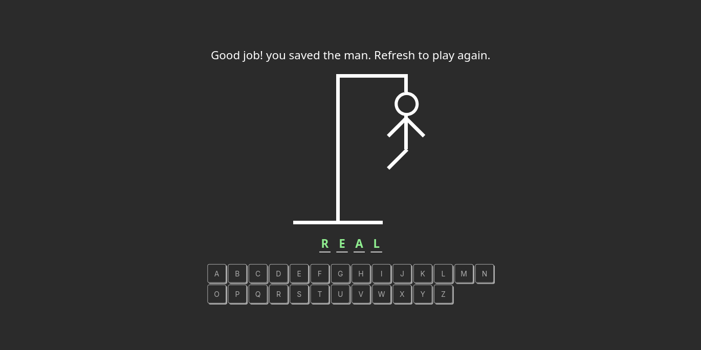

# Hangman Game

<p align="center">
  
</p>

<strong>A fun little word-guessing game with real stakes on the line ;))</strong>


---

## ✨ Features

- Guess the hidden word by only the letter counts and revealed letters which you pay for with your hp

- The poor man hangs if you fail to guess the word by the time his last remaining limb is painted

- The game uses a local database of +850 unique dictionary words giving you plenty of variety to keep playing and guessing

---

## 🛠️ Tech Stack

- **Javascript/Typescript**
- **React 19**
- **Vite 7.2.2**

---

## 🚀 Installation

#### 1. Clone the repository

```bash
git clone https://github.com/liningset/hangman-react-ts
cd hangman-react-ts
```

#### 2. Start the development server

```bash
npm run dev
```
